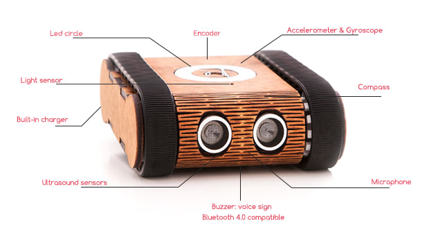

# Codie — BLE vezérlés Raspberry Pi 5-ről



*A Codie oktatórobot és szenzorai (kép: [indiegogo](https://www.indiegogo.com/en/projects/adamlipecz/codie-cute-personal-robot-that-makes-coding-fun)).*

A [csorbazoli/CodieController](https://github.com/csorbazoli/CodieController) 2016-os,
félbehagyott Java PoC-jából visszafejtett wire-protokoll tiszta Python implementációja.
A **Codie** oktatórobotot Bluetooth Low Energy-n (BlueZ) vezérli a **Node.js web-backend**
(`server/`) révén — az a láncszem, ami 2019-ben hiányzott (PC-oldali BLE út), Linuxon triviális.
A Python csomag (`codie/`) két dolgot ad: a **protokoll-referenciát** (`protocol`, `morse`,
`tunes`) és egy **szinkron REST klienst** (`api`), ami a backend HTTP felületén keresztül
szól a robotnak. A BLE réteg a backendben van.

A protokoll- és hardverrészletek a [CLAUDE.md](CLAUDE.md)-ben; a fejlődési napló a
[MEMORY.md](MEMORY.md)-ben; a verziónkénti változások a [CHANGELOG.md](CHANGELOG.md)-ben.
Aktuális verzió: **v0.5.0** (a Python BLE réteg (bleak `CodieClient`) törölve; a Python oldal
minta a JS backend REST API-jára épül).

## Projekt struktúra

```
codie/            Python package
  protocol.py     wire-protokoll (frame encode/decode, parancs-ID-k, szín-HSV 0-255)
  api.py          CodieApi — szinkron REST kliens a JS backendhez (standard library)
  tools.py        9 async agent-tool (mcp_codie_*, nincs mcp import, CodieApi-n keresztül)
  mcp_server.py   vékony FastMCP burkolat (tools.py regisztrálása, stdio)
  morse.py        szöveg → Morse-ritmus (paritás-referencia a JS port számára)
  tunes.py        beépített ritmusminták (paritás-referencia)
scripts/
  fft_pitch.py    a csipogó domináns frekvenciája (offline FFT, nem BLE)
tests/            protokoll + Morse (test_protocol.py, test_morse.py) — 30-ish unit teszt
server/           Express + socket.io web-backend (JS), több robot, robot-szűrő
  src/ble/        protocol.js, protocol-norrouting.js, client.js, scanner.js,
                  registry.js, noble.js (noble/BlueZ)
  scripts/        scan.js, control.js, console.js
  public/         a webes felület
  test/           105 unit + e2e teszt (protokoll, paritás, API, scriptek)
docs/comApi.h     hivatalos Codie BLE API header (referencia)
```

> **Két Codie-generáció van**, mindet a **JS web-backend** (`server/`) kezeli (a GATTelrendezésből
> automatikusan felismeri, melyikkel van szó). A Python csomag **nem** beszél BLE-t közvetlenül:
> a `codie/protocol.py`/`morse.py`/`tunes.py` a JS port **bájtra bájt** egyezéséért felelnek
> (a `server/test/parity.test.js` ellenőrzi), a `codie/api.py` pedig a backend REST APIn keresztül
> vezérelti a robotot. A két generáció közötti különbség a frame-formátum és a parancs-ID-k:

## Teszt eredmények

### 2026-10-20 — routing nélküli generáció (a JS web-backenddel)

| Kategória | Funkció | Állapot |
|-----------|---------|---------|
| Kapcsolat | connect (cím alapján), váratlan megszakadás után újracsatlakozás | ✅ ~10 mp alatt újra online |
| Szenzor | akku, szonár, fény, vonal, mikrofon | ✅ élő értékek, ~90 ms-onként frissülő kijelző |
| Hang | beep (hangerő + frekvencia + időtartam), Morse, beépített ritmus | ✅ a megfelelő időzítéssel |
| Mozgás | DriveSpeed, DriveDistance, DriveTurn | ✅ a robot elfogadja (20/20 beep, 10/10 LED parancs hibátlan) |
| Fény | LedSetColor (a firmware skáláján, pontos bájtokkal) | ✅ a robot elfogadja |

### 2026-07-07 — routingos generáció (a Python klienssel)

| Kategória | Funkció | Állapot |
|-----------|---------|---------|
| Szenzor | akku (SoC), fény, vonal, szonár, mikrofon | ✅ objektív adat, bájtra pontos dekódolás |
| Hang | SpeakBeep | ✅ hallható |
| Mozgás | DriveSpeed, DriveDistance, DriveTurn | ✅ kerekek pörögtek (alacsony akkun is) |
| Fény | LedSetColor (mind a 12 + egyesével) | ✅ vizuálisan igazolt, helyes színek, erős fény |

- Minden parancsot a robot `nSuccessful=0`-val nyugtázott. A protokollt a hivatalos
  Codie BLE API v1.0 (`docs/comApi.h`) teljesen igazolta.

> **Archivált:** ez a teszt a már törölt Python `bleak` klienssel készült (a `codie/client.py`
  jelenleg már nincs; a Python oldal most csak a protokoll-referenciát és a REST klienst tartalmazza).

## Telepítés

```bash
python3 -m venv .venv
.venv/bin/pip install -r requirements.txt     # a CodieApi + Morse/FFT (csak stdlib + numpy)
cd server && npm install                       # a BLE backend (BlueZ + noble)
```

A backendnek kell futnia (a Python/MCP a backend REST API-n keresztül szól a robotnak):

```bash
cd server && npm start                          # http://localhost:3000 — webes felület + REST + socket.io
```

A robot BLE-címet a `server/scripts/scan.js`-vel vagy a webes felület "Robotok keresése"
gombbal találsz (a routing nélküli generáció címe stabil: `00:07:80:66:F0:DA`); a backend
`CODIE_AUTO_CONNECT` környezeti változóval automatikusan csatlakoztatja.

## Használat (REST API)

A Python csomag a `codie.api.CodieApi` osztályon keresztül szól a backendnek — nincs
BLE-kapcsolat a Python oldalon, a backend törődik róla:

```python
from codie import CodieApi

api = CodieApi(
    base_url="http://127.0.0.1:3000",   # a server/ címe
    address="00:07:80:66:F0:DA",        # a robot BLE címe
)
api.beep(500)           # sípol 500 ms
api.led("red")          # mind a 12 LED piros
print("akku:", api.battery(), "%")
api.forward(10)         # előre 10 cm
api.stop()              # azonnali megállás
```

> A `base_url` és `address` a `CODIE_API_URL` / `CODIE_ADDRESS` környezeti változókból is
> jön (alap: `http://127.0.0.1:3000`, illetve a backend által csatlakoztatott robot). A
> `status()`, `battery()`, `sonar()`, `light()`, `line()`, `mic()` és a mozgás/hang/LED
> metódusok a backend `POST /api/robots/:address/command` végpontra kerülnek küldve.

## Webes vezérlő (Express.js backend) — `server/`

A repo mellett futó Node.js backend: **Express + socket.io**, és a robotokat BLE-en
(BlueZ D-Bus binding, root nélkül) vezérli. Több robotot is kezel, és a keresés
**csak a Codie-kat mutatja** — a többi BLE eszköz (fehallgatók, telefonok) kiszűrve.

```bash
cd server
npm install
npm start          # http://localhost:3000 — webes felület + REST + socket.io
```

A felületen:

- **élő érzékelőadatok** — a telemetria érzékelőnként érkezik, a kijelző ~90 ms-onként
  frissül (a robot egy lekérdezésre ~100 ms alatt válaszol, így a teljes
  4 érzékelős kör ~400 ms);
- **mikrofon-figyelés** — a robot nyers erősségi értékét szintmérő mutatja;
- **automatikus újracsatlakozás**, ha a BLE-kapcsolat megszakad (a robot elalvása után);
- **a hibák valódi hibák** — ha a robot nem nyugtázta a parancsot, a felület hibát ír
  (nem hamis „OK”-t).

A hálózati réteg újrahasznosítható modulokra épül, így a frontend később
tetszőlegesen átírható:

```bash
npm run scan                                   # robotok keresése (csak a robotok)
node scripts/control.js --robot <CÍM> led red  # egy parancs, non-interaktívan
node scripts/console.js                        # interaktív konzol
```

Részletek (API, socket-események, szűrők, konfig): [`server/README.md`](server/README.md).

> A JS wire-protokoll a Python `codie/protocol.py` 1:1 portja — a `server/test/parity.test.js`
> bájtra bájtra ellenőrzi, hogy a kettő ne csússzon el.

## Hang: ritmus és Morse

A hangszóró fix hangmagasságú csipogó (nincs WAV/dallam), de a ritmus vezérelhető.
A ritmus/Morse kódolása a Python `morse.py`/`tunes.py`-ben van (paritás-referencia a JS
port számára), a tényleges lejátszás a JS backend `beep`/`morse`/`tune` REST-parancsain keresztül:

```python
api.beep(1000)              # egyszerű beep
api.morse("SOS")            # Morse-kód
api.tune("shave_haircut")   # beépített ritmus
```

A csipogó **hangmagassága** telefonos felvételből mérhető (a robot mikrofonja erre kevés):

```bash
.venv/bin/python scripts/fft_pitch.py felvetel.m4a    # domináns frekvencia + felharmonikusok
```

Rendszerfüggőség az FFT-elemzéshez: `ffmpeg` (a felvétel dekódolásához).

## MCP szerver (Hermes / agent integráció)

A `codie/mcp_server.py` a `codie/tools.py`-t regisztrálja MCP-toolként, hogy a Hermes Agent
(vagy bármely MCP-kliens) magas szintű, biztonságos parancsokkal vezérelje a robotot. A toolok
a `codie.api.CodieApi` révén szólnak a JS backendnek — a BLE réteg a backendben van. Csak véges,
magától megálló mozgásparancsok (nincs runaway).

Futtatás (stdio):

```bash
CODIE_API_URL=http://127.0.0.1:3000 CODIE_ADDRESS=00:07:80:66:F0:DA \
  .venv/bin/python -m codie.mcp_server
```

### Hermes bekötés

A Hermes a `~/.hermes/config.yaml` `mcp_servers` kulcsa alatt tartja az MCP-szervereket. Mivel a
Hermes sémájában **nincs `cwd` mező**, a package elérését `PYTHONPATH`-szal adjuk meg:

```yaml
mcp_servers:
  codie:
    command: "/path/to/codie/.venv/bin/python"
    args: ["-m", "codie.mcp_server"]
    env:
      PYTHONPATH: "/path/to/codie"
      CODIE_API_URL: "http://127.0.0.1:3000"
      CODIE_ADDRESS: "00:07:80:66:F0:DA"
    timeout: 30                           # hosszabb say_morse / mozgás miatt
    supports_parallel_tool_calls: false   # egy robot -> soros végrehajtás
```

A Hermes a toolokat `mcp_codie_<tool>` néven látja (pl. `mcp_codie_drive_forward`). Config után a
`/reload-mcp` frissíti a kapcsolatot.

> A `/path/to/codie`-t cseréld a klón tényleges abszolút útjára (ez a helyi
> `~/.hermes/config.yaml`-ba kerül, ami nincs verziózva).

Toolok: `status`, `look_ahead`, `drive_forward(cm)`, `drive_backward(cm)`, `turn(deg)`,
`stop`, `beep(ms)`, `say_morse(text)`, `set_leds(color)`.

### Hermes skill (playbook)

A toolok a „kezek", de az agentnek playbook is kell — ezt adja a
`hermes/skills/robotics/codie-robot/SKILL.md`: mikor és hogyan használja a robotot (érzékelj
mozgás előtt, csak véges parancs, töltő↔LED ütközés, fix csipogó, BLE-késleltetés, biztonság).
A skill `requires_tools`-szal a `mcp_codie_*` toolokhoz kötött — csak akkor bukkan fel, ha a
szerver be van kötve.

Hogy a Hermes lássa, a `~/.hermes/config.yaml`-ban mutass rá a repó skill-könyvtárára (így
verziózva marad):

```yaml
skills:
  external_dirs:
    - /path/to/codie/hermes/skills
```

Vagy másold be: `cp -r hermes/skills/robotics ~/.hermes/skills/`. Hívható a `/codie-robot`
slash-sel is.

## Unit tesztek (robot nélkül)

```bash
.venv/bin/python -m unittest discover -s tests -v
```

## Parancsok

| Metódus (`CodieApi`) | REST parancs | BLE parancs | Megjegyzés |
|---------|---------------|-------------|-----------|
| `beep(ms)` | `beep` | SpeakBeep (0x1064) | max 10000 ms |
| `morse(text)` | `morse` | SpeakBeep sorozat | fix hangmagasság (2483 Hz) → **ritmus**, nem dallam |
| `tune(name)` | `tune` | SpeakBeep sorozat | beépített ritmusok (`tunes.py`-ból) |
| `led(color)` | `led` | LedSetColor (0x1065) | színek: white, green, red, blue, cyan, yellow, orange |
| `led_anim(animation, color="red")` | `ledAnim` | SET_ANIMATION (0x0009) | animáció 0 vagy 1; csak routing nélküli gen |
| `forward(cm)` | `forward` | DriveDistance (0x1061) | 0..200 cm |
| `backward(cm)` | `backward` | DriveDistance (0x1061, −speed) | 0..200 cm |
| `turn(degrees)` | `turn` | DriveTurn (0x1062) | pozitív fok = **jobbra** |
| `stop()` | `stop` | DriveSpeed (0x1060, 0,0) | azonnali megállás |
| `battery()` | `battery` | BatteryGetSoc (0x1069) | % |
| `sonar()` | `sonar` | SonarGetRange (0x1063) | mm |
| `light()` | `light` | LightSenseGetRaw (0x106a) | raw (12 bit) |
| `line()` | `line` | LineGetRaw (0x106b) | `{value, level, onLine}` |
| `mic()` | `mic` | MicGetRaw (0x106c) | raw (0..~2048) |
| `status()` | `status` | összes fenti | akku %, szonár mm, fény, vonal |

